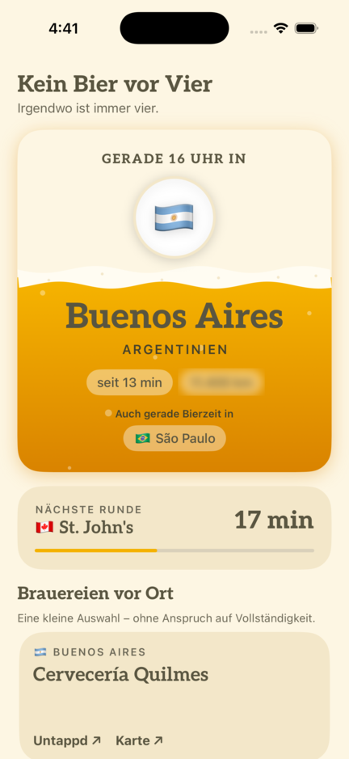
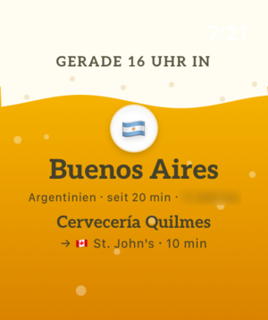

<p align="center">
  
</p>

# Kein Bier vor Vier 🍺 · It's 5 O'Clock Somewhere

[](https://github.com/omphteliba/kein-bier-vor-vier/actions/workflows/build.yml)
[](https://github.com/omphteliba/kein-bier-vor-vier/actions/workflows/ios.yml)
[](LICENSE)

Eine nicht ganz ernst gemeinte App für Smartwatch und Handy – für Android und Wear OS, iPhone und Apple Watch: Sie zeigt, in welcher Zeitzone es **gerade 16 Uhr** ist – und wo als Nächstes. Irgendwo auf der Welt ist schließlich immer vier.

Inspiriert von den Wanduhren, auf denen statt 1–12 überall nur die 4 steht. Die englische Ausgabe folgt dem Spruch *„It's five o'clock somewhere“* und rechnet deshalb mit 17 Uhr.

<p align="center">
  
  &nbsp;
  
</p>
<p align="center">
  
  
  
</p>

<p align="center">
  
  
</p>

## Was drin ist

- **Handy-App:** Bierglas mit Flagge, Stadt, Land und Entfernung zu dir, dazu die anderen Orte mit gleicher Uhrzeit; ein Karussell mit Brauereien der Orte, an denen gerade Bierzeit ist (Untappd, Website, Karte) und am Ende Google Maps für alle Brauereien in der Nähe; nächste Runde mit Countdown, die Runden der nächsten 12 Stunden. Tipp auf einen Ort öffnet Google Maps. Der Spruch (16 oder 17 Uhr) folgt der Sprache oder lässt sich in den Einstellungen wählen.
- **Homescreen-Widget,** das sich zu jeder neuen Runde aktualisiert.
- **Wear-OS-App** als „volles Glas“, dazu zwei **Complications** für beliebige Zifferblätter.
- **Zwei eigene Zifferblätter:** „Kein Bier vor Vier“ (zwölfmal die 4) und „It's 5 O'Clock Somewhere“ (zwölfmal die 5).
- Deutsch und Englisch, 54 Orte inklusive der Zeitzonen mit halben und Viertelstunden, Sommerzeit inklusive.
- **Brauerei des Tages:** pro Ort eine kleine Auswahl großer und kleiner Brauereien – ohne Anspruch auf Vollständigkeit –, die sich täglich abwechseln; aktuelle Biere findest du über den Link zu Untappd. Deutschland, Frankreich und Belgien teilen sich die 16-Uhr-Runde. Quellen: [docs/beer-sources.md](docs/beer-sources.md).

## Aufbau

| Modul | Inhalt |
|---|---|
| `core/` | Reine Kotlin-Logik: Zeitzonen, Sommerzeit, Countdown, beide Editionen, Orte, Brauereien, Entfernung – mit Tests |
| `common/` | Android-Teile für Uhr und Handy: Texte, Standortabfrage, Farben, das Bierglas, die Schrift [Aleo](common/fonts/README.md) |
| `phone/` | Handy-App und Widget (Jetpack Compose, Glance) |
| `wear/` | Wear-OS-App und Complications (Compose for Wear OS) |
| `watchface/` | Zifferblätter im Watch Face Format, beide Varianten aus einer Vorlage (`src/main/watchface/watchface.xml`); Flagge, Stadt und Countdown kommen aus den Complications der App |
| `ios/` | iPhone-App, Widget, Apple-Watch-App und Komplikationen (SwiftUI, WidgetKit); Projekt per [XcodeGen](https://github.com/yonaskolb/XcodeGen) aus `ios/project.yml`, Logik im Swift-Paket `ios/BeerCore` |
| `data/spots.json` | Orte und Brauereien für beide Plattformen; `tools/make_spots.py` erzeugt daraus die Kotlin-Liste |
| `tools/` | `make_logo.py` erzeugt Logo ([`docs/logo/`](docs/logo/)) und App-Icon, `make_foam.py` die Schaumwelle für Widget und Zifferblatt |


## Barrierefreiheit

- Textfarben erfüllen WCAG AA: `#595540` (7,0 : 1 auf Creme), `#6B6756` (5,3 : 1 auf Creme, 4,6 : 1 auf den Karten) und `#45412B` für kleine Schrift auf dem Bier (5,6 : 1)
- TalkBack liest Karten als Einheit vor, Großbuchstaben normal, Deko (Mini-Uhr, Symbole) wird übersprungen; Überschriften sind als solche markiert
- Tippflächen mindestens 48 dp; Layout wächst mit großer Schrift (getestet mit 200 %)
- Die Bläschen stehen still, wenn in Android „Animationen entfernen“ aktiv ist
- Das Widget hat eine Vorlesebeschreibung; die Complications der Uhr ebenso

## Bauen & testen

Voraussetzung: Android Studio (inkl. Android SDK).

```bash
./gradlew :core:test                  # Logik testen
./gradlew :phone:assembleDebug        # Handy-App bauen
./gradlew :wear:assembleDebug         # Uhren-App bauen
./gradlew :watchface:assembleDebug    # beide Zifferblätter bauen
```

**iPhone und Apple Watch** werden ohne eigenen Mac auf GitHubs macOS-Servern gebaut und getestet ([iOS-Workflow](https://github.com/omphteliba/kein-bier-vor-vier/actions/workflows/ios.yml)); die Simulator-Screenshots hängen am jeweiligen Lauf. Mit einem Mac: `brew install xcodegen`, dann `cd ios && xcodegen` und `KeinBierVorVier.xcodeproj` öffnen.

Bei jedem Push laufen Tests und Builds auch auf GitHub; die fertigen Debug-APKs hängen am jeweiligen [Build](https://github.com/omphteliba/kein-bier-vor-vier/actions/workflows/build.yml).

Zum Ausprobieren in Android Studio einen Wear-OS-Emulator anlegen, die Run-Konfiguration `wear` starten und ein Zifferblatt installieren und aktivieren:

```bash
adb install -r watchface/build/outputs/apk/vier/debug/watchface-vier-debug.apk
adb shell am broadcast -a com.google.android.wearable.app.DEBUG_SURFACE --es operation set-watchface --es watchFaceId de.keinbiervorvier.watchface.vier
```

## Lizenz

Der Code steht unter der [MIT-Lizenz](LICENSE). Die Schrift Aleo (`common/src/main/res/font/aleo.ttf`) ist davon ausgenommen und steht unter der [SIL Open Font License 1.1](common/fonts/Aleo-OFL.txt).

## Mitwirkende

- Oliver Hörold
- Claude (Anthropic) – Co-Autor, entwickelt mit [Claude Code](https://claude.com/claude-code)

---

Bitte verantwortungsvoll genießen. 🍻
